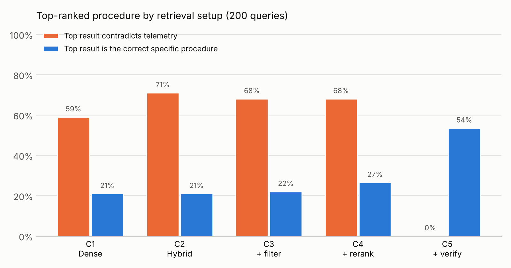

# Constraint-aware retrieval

Semantic search finds the runbook procedure that is *about* a hardware symptom. It can't tell whether
that procedure *applies* to the device in front of you: whether a counter crossed a threshold, whether
the error was contained, whether the hardware generation matches.

This repository measures that gap and tests a simple fix: each procedure's conditions are stored as data
and checked against the device's telemetry before an AI assistant sees the procedure.

**New here? Start with the [walkthrough](docs/walkthrough.md)**, which follows one real question through
the data and all five setups.

```
question ──► retrieve candidates ──► check preconditions against telemetry ──► evidence
             (BM25 + embeddings,      PASS keep · FAIL drop · UNKNOWN flag
              filter, rerank)
```

## Results

200 operator questions over a synthetic 300-GPU fleet, top 3 results per setup. Latency was measured on a 4-core CPU and will vary by machine; every other number reproduces exactly from the fixed seed.

| Setup | First suggestion doesn't fit the GPU ↓ | First suggestion is right ↑ | Right procedures found in top 3 ↑ | Latency p50 |
|---|---|---|---|---|
| C1 Dense embeddings | 59% | 21% | 45% | 47 ms |
| C2 Hybrid (BM25 + dense) | 71% | 21% | 47% | 47 ms |
| C3 + hardware-class filter | 68% | 22% | 51% | 47 ms |
| C4 + cross-encoder rerank | 68% | 27% | 47% | 732 ms |
| **C5 + precondition check** | **0%** | **54%** | **90%** | 742 ms |



- Without the check, the top result contradicted the device's telemetry in 59–71% of questions.
  Hybrid search, filtering and reranking didn't fix it.
- The check doubled recall: removing procedures that can't apply frees room for the ones that can.
- C5's 0% is by construction, because labels and checker share the same preconditions. The real test is
  what happens when the inputs are imperfect:
  - **Missing telemetry:** handled safely. Results were flagged and recall fell, but nothing slipped
    through unflagged.
  - **Wrong preconditions:** not handled safely. With 10% of clauses wrong, 26% of questions got an
    unflagged violation.

Full tables, per-category breakdowns, robustness runs and the embedding probe are in
**[results/README.md](results/README.md)**. To see every question with what each setup suggested first,
open **[results/per_question.csv](results/per_question.csv)**.

## Run it

```bash
pip install -e ".[dev]"
./scripts/reproduce.sh
```

This runs the tests, regenerates the data from a fixed seed, runs the probe, all five setups and both
robustness tests, then rebuilds the tables and figures. It takes 10–15 minutes on a 4-core CPU. The
two open models download from Hugging Face on the first run.

## How it works

**Procedures** are Markdown files with their conditions in the front matter
([example](data/corpus/procedures/proc-003.md)):

```yaml
id: PROC-003
title: "Uncorrected, contained GPU memory error (class A): restart the affected job"
device_classes: [class_a]
preconditions:
  - {metric: ecc_uncorrected, window: 24h, op: ">=", value: 1}
  - {metric: ecc_uncontained, window: 24h, op: "==", value: 0}
```

**The checker** ([`verify/check.py`](src/car/verify/check.py)) returns PASS, FAIL or UNKNOWN. A missing
value is UNKNOWN, never PASS. It filters the ranking and never reorders it.

**The benchmark** has 26 procedures across six topics, 300 devices with 30 days of telemetry, and 200
questions split evenly into five categories: numerical threshold, error-type contrast, device class,
temporal and distractor. Each question comes from a fault injected into one device's telemetry, and its
labels are computed from that device's true state. See [data/DATA_CARD.md](data/DATA_CARD.md).

| Path | Contents |
|---|---|
| `src/car/generate/` | Fleet, fault scenarios, questions and labels |
| `src/car/retrieve/pipeline.py` | The five setups, C1–C5 |
| `src/car/verify/check.py` | Precondition checker |
| `src/car/probe/` | Do embeddings separate numbers? |
| `src/car/eval/` | Metrics, experiment runner, figures, results page |
| `configs/` | Data seed and sizes; models, k, robustness levels |
| `docs/` | Step-by-step walkthrough with diagrams |

To try your own procedures, add Markdown files to `data/corpus/procedures/`. Metrics and windows are
defined in [`src/car/telemetry.py`](src/car/telemetry.py).

## Related work

Filtering retrieval by structured metadata, combining text with structured data, checking retrieved
evidence before generation, and rule-based checks of whether guidance applies to a specific case (as in
clinical decision support) are all established ideas. This repository applies that pattern, explicit
precondition checks, to hardware runbooks and measures the effect on a controlled benchmark.

Prior work this builds on:

- Filtered vector search: [Filtered-DiskANN](https://doi.org/10.1145/3543507.3583552) (Gollapudi et al., WWW 2023)
- Text plus structured data: [HybridQA](https://arxiv.org/abs/2004.07347) (Chen et al., 2020);
  [Table-Augmented Generation](https://arxiv.org/abs/2408.14717) (Biswal et al., CIDR 2025)
- Checking retrieved evidence: [Corrective RAG](https://arxiv.org/abs/2401.15884) (Yan et al., 2024);
  [Self-RAG](https://arxiv.org/abs/2310.11511) (Asai et al., ICLR 2024)
- Rule-based applicability checks: the Arden Syntax standard for clinical decision support (Samwald et al.,
  *J. Biomed. Inform.* 45(4), 2012); [TrialGPT](https://doi.org/10.1038/s41467-024-53081-z) (Jin et al.,
  *Nature Communications*, 2024)
- AI for incident diagnosis: [RCACopilot](https://arxiv.org/abs/2305.15778) (Chen et al., EuroSys 2024)
- Numbers in embeddings: [Wallace et al.](https://aclanthology.org/D19-1534/) (EMNLP 2019)

Methods used in the experiment: [BGE](https://arxiv.org/abs/2309.07597) embeddings,
[BM25](https://doi.org/10.1561/1500000019), [reciprocal rank fusion](https://doi.org/10.1145/1571941.1572114)
and [cross-encoder reranking](https://arxiv.org/abs/1901.04085).

## Limits

The fleet, procedures and questions are synthetic, the corpus is small, and the labels come
from a single set of rules. Results show the size of the relevance-vs-applicability gap under controlled
conditions, not real-world accuracy. **The procedures and thresholds are fictional and are not vendor
guidance.**

## Acknowledgments

This project was built with the help of [Claude Code](https://claude.com/claude-code).

## License

Apache-2.0
