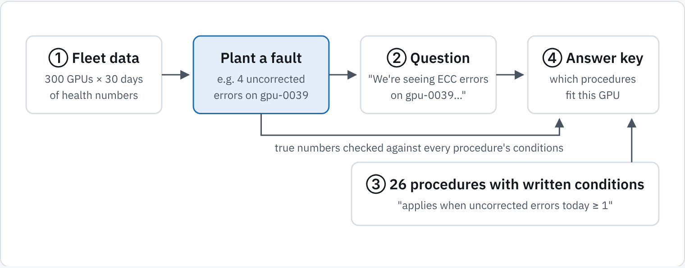

# Walkthrough: the data and how it works

This page explains the benchmark step by step and follows one real question from start to finish. For
every table, see [results/README.md](../results/README.md).

## The problem in one example

An operator asks: *"We're seeing ECC errors on gpu-0039. How should we handle it?"* Two procedures in
the runbook both talk about GPU memory errors:

| Procedure | Applies when | Action |
|---|---|---|
| Corrected errors, low rate: monitor | 1–99 corrected errors today, no uncorrected errors this week | Leave it running |
| Uncorrected error (class B): drain and reboot | 1 or more uncorrected errors today, class B GPU | Take it out of service |

A search engine sees almost the same words. The difference is a number in the GPU's data: gpu-0039 had
**4 uncorrected errors today**, so only the second procedure is right.

## The data

Everything is synthetic, so the right answer to every question is known. There are four pieces:



### ① Fleet data

300 fictional GPUs in two hardware models (150 class A, 150 class B). There is one row per GPU per day
for 30 days, with 15 measurements per row. File: [`data/telemetry/fleet.csv.gz`](../data/telemetry/fleet.csv.gz)

gpu-0039's last week, with the planted fault on day 29:

| Day | Peak temp °C | Corrected memory errors | Uncorrected memory errors | PCIe replays | GPU-link errors |
|---|---|---|---|---|---|
| 23 | 61.0 | 0 | 0 | 0 | 0 |
| 24 | 63.6 | 0 | 0 | 0 | 0 |
| 25 | 58.6 | 0 | 0 | 0 | 0 |
| 26 | 53.8 | 0 | 0 | 0 | 8 |
| 27 | 59.5 | 0 | 0 | 0 | 0 |
| 28 | 60.7 | 0 | 0 | 0 | 0 |
| **29 (today)** | **56.4** | **0** | **4** | **0** | **0** |

The other 10 columns are thermal throttling, uncontained memory errors, memory-repair pending and
failed, PCIe link width, links down, power brake events, power supply status, and corrected and
uncorrected server memory errors. Class B GPUs don't report the three memory-repair and containment
columns, so those are empty for them.

Conditions can look at three time windows:

| Window | Meaning |
|---|---|
| `now` | today's value |
| `24h` | today's value |
| `7d` | the last 7 days: counts added up, temperature and status flags at their highest, link width at its lowest. If any day is missing, the window counts as missing. |

### ② Questions

200 questions, one per GPU, worded the way an operator would ask. The question names the symptom. The
deciding numbers are only in the GPU's data. File: [`data/queries/queries.jsonl`](../data/queries/queries.jsonl)

| Kind (40 each) | What makes it tricky | Example |
|---|---|---|
| Numbers | The action depends on a count or temperature | "gpu-0177 shows ECC memory errors in its health check. Next steps?" |
| Error type | Same words, different kind of error | "…hit an uncorrectable ECC error and a job crashed. What now?" |
| Hardware model | Same question, different procedure per GPU model | "We're seeing ECC errors on gpu-0039…" |
| Timing | It happened earlier this week, not today | "…had a burst of PCIe replays a few days ago. What should we do now?" |
| Look-alike | The words point to one topic, the data to another | "…'s node is reporting memory errors." (server memory) |

Each question comes from a fault scenario in
[`src/car/generate/scenarios.py`](../src/car/generate/scenarios.py), which changes one GPU's data so that a
specific procedure applies.

### ③ Procedures

26 runbook procedures for six kinds of problems: GPU memory, temperature, PCIe, GPU-to-GPU links, power,
and server memory. Each is a Markdown file whose header lists when it applies. Folder:
[`data/corpus/procedures/`](../data/corpus/procedures/)

```yaml
id: PROC-005
title: "Uncorrected GPU memory error (class B): drain and reboot to retire pages"
device_classes: [class_b]                                      # only class B GPUs
preconditions:
  - {metric: ecc_uncorrected, window: 24h, op: ">=", value: 1}   # 1+ uncorrected errors today
```

Five procedures are generic "collect the logs first" steps with no conditions, one for each topic
except server memory.

### ④ Answer key

For every question, each procedure's conditions are checked against that GPU's true numbers. Procedures
that pass and are about the question's topic are the right answers. File:
[`data/queries/qrels.jsonl`](../data/queries/qrels.jsonl)

For gpu-0039:

| Procedure | Its condition | gpu-0039 today | Fits? |
|---|---|---|---|
| PROC-005 Uncorrected error, class B: drain and reboot | class B, uncorrected ≥ 1 | class B, 4 | ✓ right answer |
| PROC-001 Corrected errors, low rate: monitor | corrected 1–99, no uncorrected this week | corrected 0, uncorrected 4 | ✗ |
| PROC-002 Corrected errors, high rate: diagnostics | corrected ≥ 100 | corrected 0 | ✗ |
| PROC-003 Contained error, class A: restart job | class A only | class B | ✗ |
| PROC-006 Past errors, none today: review history | uncorrected today = 0 | 4 | ✗ |
| PROC-009 GPU memory: collect logs first | none | n/a | ✓ generic |

## How it works

### Five setups

Each setup takes the question and returns its top 3 procedures. C1 to C4 are standard retrieval
setups. They see the GPU's numbers pasted into the question as text. C5 is the idea being tested.
Code: [`src/car/retrieve/pipeline.py`](../src/car/retrieve/pipeline.py)


| | What it does | Model or method |
|---|---|---|
| C1 | Picks procedures that sound most like the question | `BAAI/bge-small-en-v1.5` embeddings |
| C2 | Also matches exact keywords | BM25, merged with reciprocal rank fusion (k = 60) |
| C3 | Keeps only procedures written for the GPU's hardware model | metadata filter |
| C4 | A second model re-sorts the top 20 | `cross-encoder/ms-marco-MiniLM-L-6-v2` |
| C5 | Removes procedures whose conditions are false for this GPU | the check below |

### The check

Code: [`src/car/verify/check.py`](../src/car/verify/check.py)


Two rules: missing data never counts as a pass, and the check only removes procedures. It never
changes their order.

### The example question through all five setups

These are each setup's actual top 3 for gpu-0039 (✗ = its own conditions say it doesn't fit):

| Setup | 1st | 2nd | 3rd |
|---|---|---|---|
| C1 | ✗ 001 Monitor | ✗ 006 Review history | ✗ 003 Restart job (class A) |
| C2 | ✗ 003 Restart job (class A) | ✗ 001 Monitor | ✓ 009 Collect logs |
| C3 | ✗ 001 Monitor | ✓ 009 Collect logs | ✗ 002 Run diagnostics |
| C4 | ✗ 002 Run diagnostics | ✗ 001 Monitor | ✓ **005 Drain and reboot** |
| **C5** | ✓ **005 Drain and reboot** | ✓ 009 Collect logs | ✓ 021 GPU-link triage |

C4 had the right procedure in third place. C5 removed the two procedures above it, and it moved to
first. Every question is listed like this in [`results/per_question.csv`](../results/per_question.csv).

## How it's scored

| Measure | Meaning | Better |
|---|---|---|
| First suggestion doesn't fit | The 1st procedure's conditions are false for the GPU | lower |
| First suggestion is right | The 1st procedure is the specific right one | higher |
| Right procedures found in top 3 | Share of the right procedures that made the top 3 | higher |

| Setup | Doesn't fit | Right | Found in top 3 |
|---|---|---|---|
| C1 | 59% | 21% | 45% |
| C2 | 71% | 21% | 47% |
| C3 | 68% | 22% | 51% |
| C4 | 68% | 27% | 47% |
| **C5** | **0%** | **54%** | **90%** |

C5's 0% is partly by design: it checks the same conditions used to build the answer key. The finding is
how often C1 to C4 break those conditions. The stress tests in [results/README.md](../results/README.md)
show what happens when the data is missing (C5 stays safe) or the conditions are written wrong (C5 gets
fooled).

## Run it yourself

```bash
pip install -e ".[dev]"
./scripts/reproduce.sh
```

The fleet, procedures and thresholds are fictional and are not vendor guidance.
