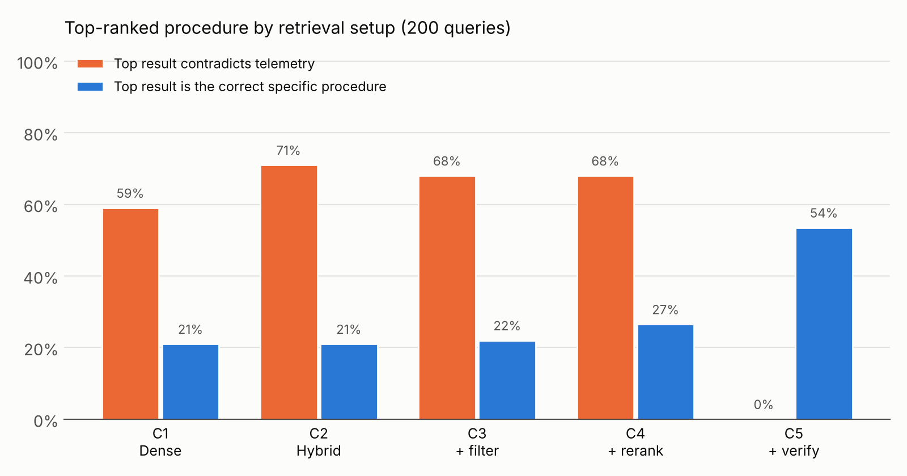
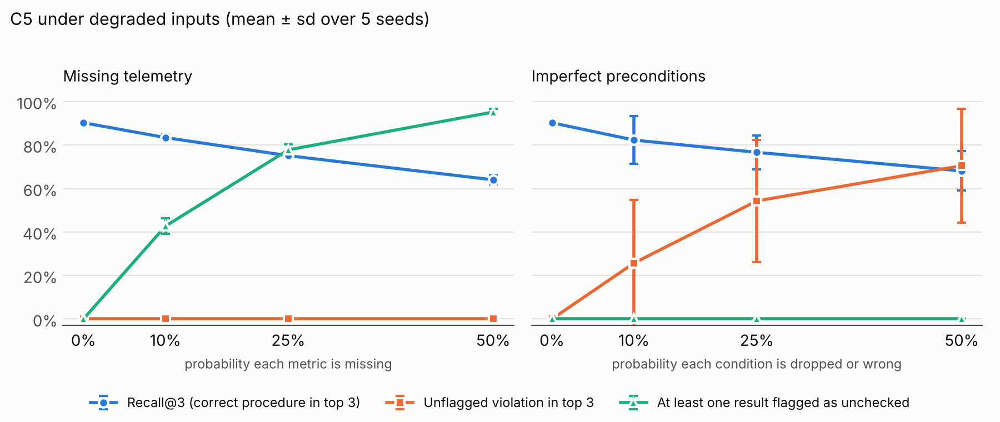

# Results

Generated by `python -m car.eval.report` from the files in this folder. 200 queries, top 3 results per setup.
Latency depends on the machine (4-core CPU here); all other numbers reproduce exactly from the fixed seed.

**Top-1 violation:** the first result's preconditions are false for the device.
**Top-1 correct:** the first result is the specific procedure that applies.
**Recall@3:** share of applicable specific procedures found in the top 3.

## Main comparison

| Setup | Top-1 violation ↓ | Top-1 correct ↑ | Recall@3 ↑ | Violations in top 3 ↓ | nDCG@3 ↑ | Latency p50 |
|---|---|---|---|---|---|---|
| C1 Dense | 59% | 21% | 45% | 63% | 0.41 | 47 ms |
| C2 Hybrid | 71% | 21% | 47% | 70% | 0.36 | 47 ms |
| C3 + class filter | 68% | 22% | 51% | 63% | 0.41 | 47 ms |
| C4 + rerank | 68% | 27% | 47% | 72% | 0.35 | 732 ms |
| C5 + verification | 0% | 54% | 90% | 0% | 0.78 | 742 ms |

C5's zero violations follow by construction when preconditions are correct, because the labels use the
same preconditions. The ablations below show what happens when they are wrong.

## Top-1 violation by category

| Category | C1 | C2 | C3 | C4 | C5 |
|---|---|---|---|---|---|
| Numerical threshold | 48% | 57% | 53% | 70% | 0% |
| Error-type contrast | 53% | 75% | 75% | 75% | 0% |
| Device class | 93% | 73% | 68% | 45% | 0% |
| Temporal | 35% | 60% | 57% | 57% | 0% |
| Distractor | 68% | 90% | 88% | 93% | 0% |

## Top-1 correct by category

| Category | C1 | C2 | C3 | C4 | C5 |
|---|---|---|---|---|---|
| Numerical threshold | 33% | 33% | 38% | 20% | 60% |
| Error-type contrast | 15% | 20% | 20% | 23% | 53% |
| Device class | 0% | 15% | 15% | 55% | 98% |
| Temporal | 40% | 28% | 28% | 35% | 43% |
| Distractor | 18% | 10% | 10% | 0% | 15% |

## Recall@3 by category

| Category | C1 | C2 | C3 | C4 | C5 |
|---|---|---|---|---|---|
| Numerical threshold | 83% | 73% | 75% | 55% | 100% |
| Error-type contrast | 24% | 31% | 36% | 34% | 71% |
| Device class | 28% | 50% | 57% | 95% | 100% |
| Temporal | 60% | 45% | 50% | 45% | 85% |
| Distractor | 33% | 38% | 38% | 8% | 95% |

## Robustness of C5 (mean ± sd over 5 seeds)

**Missing telemetry:** each metric removed for the queried device with the given probability.

| Metric missing | Recall@3 | Unflagged violation in top 3 | Flagged result in top 3 |
|---|---|---|---|
| 0% | 90% ± 0% | 0% ± 0% | 0% ± 0% |
| 10% | 83% ± 2% | 0% ± 0% | 43% ± 4% |
| 25% | 75% ± 1% | 0% ± 0% | 78% ± 3% |
| 50% | 64% ± 2% | 0% ± 0% | 95% ± 1% |

**Imperfect preconditions:** each precondition clause dropped or given a wrong threshold with the given
probability, simulating authoring or extraction errors.

| Clause dropped or wrong | Recall@3 | Unflagged violation in top 3 | Flagged result in top 3 |
|---|---|---|---|
| 0% | 90% ± 0% | 0% ± 0% | 0% ± 0% |
| 10% | 82% ± 11% | 26% ± 29% | 0% ± 0% |
| 25% | 77% ± 8% | 54% ± 28% | 0% ± 0% |
| 50% | 68% ± 9% | 71% ± 26% | 0% ± 0% |

## Embedding probe

| Sentence pair (cosine similarity) | bge-small-en-v1.5 | all-MiniLM-L6-v2 |
|---|---|---|
| number only: 0 vs 3 uncorrectable | 0.897 | 0.916 |
| number only: 3 vs 250 uncorrectable | 0.934 | 0.953 |
| number only: 84 °C vs 91 °C | 0.931 | 0.963 |
| one word: corrected vs uncorrected | 0.955 | 0.965 |
| paraphrase, same facts (reference) | 0.912 | 0.901 |
| different topic (reference) | 0.653 | 0.357 |

| Threshold test (AUC, 0.5 = chance) | bge-small-en-v1.5 | all-MiniLM-L6-v2 |
|---|---|---|
| corrected ECC errors > 100 | 0.64 | 0.46 |
| peak temperature >= 90 °C | 0.85 | 0.89 |

## Run details

- Embedding model: `BAAI/bge-small-en-v1.5` (revision `5c38ec7c405e`)
- Reranker: `cross-encoder/ms-marco-MiniLM-L-6-v2` (revision `233902d25c44`)
- Python 3.13.18, torch 2.15.0+cpu, sentence-transformers 6.3.0, CPU only
- Every question with what each setup put first: [`per_question.csv`](per_question.csv)
- Raw per-query outputs: `per_query.jsonl`
